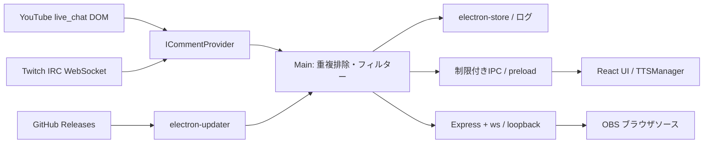

# CastPanel

Windowsでは `build.bat` をダブルクリックすると、未導入の依存関係をインストールし、型チェック・アプリビルド・Windowsインストーラー作成を実行します。成果物は `release/` に出力し、GitHubには公開しません。アプリのビルドだけなら `build.bat --build-only` を実行してください（出力先 `dist/`）。終了時は結果確認のためキー入力を待ちます。依存関係の更新後は先に `npm ci` を実行してください。

Electron + Vite + React + TypeScript製のコメント統合ビュアー。OneCommeの主要機能を参考にした独立実装です。OneComme固有のプラグイン、テンプレート、通信プロトコルとのバイナリ互換性はありません。

## 起動

Node.js 22.12以上（または24）、npmが必要です。

```sh
npm ci
npm run dev
npm test
npm run build
npm run dist
```

初回導入は`npm install`。生成されたpackage-lock.jsonをバージョン管理し、以降は`npm ci`を使用します。設定変更は「保存・接続を適用」で反映します。接続トグルをOFFで保存すると受信を停止します。

## 構成



```text
src/
  shared/ types.ts, filter.ts       データ契約・共通処理
  main/
    main.ts                        起動・IPC検証・受信パイプライン・更新
    storage.ts                     設定・名簿・直列ログ書き出し
    server.ts                      OBS HTML・WebSocket・4テーマ
    providers/
      ICommentProvider.ts          接続アダプター契約
      youtube.ts                   非表示・隔離BrowserWindow + MutationObserver
      twitch.ts                    IRCタグ解析・PING応答・再接続
  preload/index.ts                 必要な操作だけ公開
  renderer/                        React設定画面・名簿・TTS
tests/core.test.ts                 NG処理・IRC解析の検証
.github/workflows/release.yml       3 OSビルド・GitHub Releases
electron-builder.yml               パッケージ・更新配布先
```

## 動作と保存仕様

- 接続ごとに接続・読み上げ・名簿記録・ログ出力を独立指定。
- 名簿は`platform:userId`キーで保存し、同名ユーザーやプラットフォーム間の衝突を回避。firstSeen、lastSeen、累計count、直近100件のgiftsを保存。初見は名簿に未登録の最初のコメント。名簿記録OFFでは初見検出もしません。
- フィルターは名簿・ログ・OBS・TTSの前に実行。非表示コメントは記録対象外。伏字コメントは伏字で記録。置換はTTSだけに適用。
- electron-storeの設定・名簿はElectronの`app.getPath('userData')`内。ログは同ディレクトリの`logs/YYYY-MM-DD_platform.txt`。日付はローカル日付、行の時刻はISO UTC。ログは追記を直列化し、終了時にflush。
- 一覧は300コメント、重複IDは5000件、TTS待機は30件に制限。ログ・名簿はバックアップや定期整理を利用者側で実施してください。保存データは暗号化していません。
- OBS URL: `http://127.0.0.1:11180/overlay`。幅800、高さ900程度でブラウザソースを追加。背景透過、最新20件表示。初回同期で古いギフト演出を再生せず、新着時のみ通知。
- サーバーは127.0.0.1だけで待受。WebSocketは同一ポートのOriginを検証。OBSには設定の接続先や名簿を送信しません。ローカルでURLへアクセスできるプロセスはコメントを閲覧できます。
- UIはcontextIsolation/sandbox有効、Node無効。リモートYouTubeにはpreloadもIPCも公開しません。外部コメントはtextContent/Reactで描画します。

## プラットフォーム対応と制約

### YouTube

APIキー不要。`@handle`、`UC...`、watch/live/shorts/youtu.beの配信URLに対応。チャンネル指定は`/live`のcanonical URLから配信IDを解決します。解決できない場合は配信URLを直接入力してください。

非表示BrowserWindowの永続セッションでlive_chatを開き、isolated world内のMutationObserverでテキスト・SuperChat・有料スタンプ・メンバーシップの要素を抽出します。メッセージ内画像は代替テキストとURLを抽出します。UI/OBSでは代替テキストを表示し、画像の描画・アニメーションスタンプ再生は未対応です。初回にDOM内にある履歴も受信対象です。

DOMは非公開契約のためサービス変更で壊れる場合があります。同意画面・ログイン必須・年齢制限・チャット無効などは自動回避しません。自動ログインUIは未実装。コメント削除/モデレーション同期・過去ログ復元は未対応。YouTube自動再接続/配信移動追従は未実装で、停止→接続を適用して再接続します。

金額ラベルは取得しますが、多言語通貨表記を誤認しないようYouTubeの数値amount/currencyはJPY、US$、EUR、GBPの明示的な表記だけ正規化します。曖昧な$単独などはラベルのまま扱います。ギフトは通知と色強調を行い、数値1000以上の追加色強調はamountが得られるイベントだけです。通貨間レート換算・金額段階ごとの演出設定は未実装です。

### Twitch

ユーザー名を入力し匿名IRCで受信。タグで取得できるBits、USERNOTICEのサブスク系イベント、custom-reward-id付きメッセージを正規化します。切断から5秒後に再接続。チャンネルポイントの全引換イベントや無言引換は匿名IRCでは取得できません。公式EventSub + OAuth認可が必要で、この認証フローは未実装です。Twitchエモート画像解決は未実装で本文文字列を表示します。匿名接続で配信されないイベントの取得は保証しません。

### ツイキャス・追加サービス

`ICommentProvider`のconnect/disconnectを実装し、main.tsのfactory分岐とUIに接続エントリーを追加します。ツイキャスの実取得は未実装です。型として予約済みで、選択された場合は明示的に未対応状態を表示します。接続時の失敗は必ずdisconnectでリソース解放してください。

## 音声

Web Speech APIはOS/Chromiumの日本語音声を利用します。環境によって音声がインストールされていない場合があります。読み上げはUIプロセスで動作します。

VOICEVOXは別途エンジンを起動し、127.0.0.1:50021のaudio_query→synthesisでWAVを生成します。speaker IDはエンジンに存在する値を指定。CORS設定も確認してください。

VOICEPEAKはVOICEVOXと同じHTTP APIを標準提供する製品として扱いません。`ITTSEngine`で専用のライセンス条件に沿ったローカルブリッジを実装してください。現在選択すると未設定エラーで読み上げをスキップします。TTSのエラーは開発者コンソールに出力し、1件20秒でキャンセルします。

## 確認手順

1. 起動し、未接続のまま「デモコメント」を押す。初回だけ初見、2回目以降は名簿件数が加算されることを確認。
2. 接続カードの読み上げ・ログをONにして保存。デモを送り音声とログファイルを確認。OFFで保存して停止を確認。
3. NGワードに「こんにちは」を設定し、伏字/非表示それぞれでデモを確認。OBS・ログ・音声への反映も確認。
4. OBSにURLを追加し、4テーマの切替を保存。デモのギフト通知が表示され、OBS再読込時には再演出されないことを確認。
5. 自分の公開YouTubeライブURL、Twitchチャンネルで実際にコメントを送信。初見、絵文字代替テキスト、利用可能なギフトイベントを確認。
6. アプリを再起動し接続設定・名簿が保持されること、ログに追記されることを確認。
7. 11180番を他プロセスが使用している場合、UIに起動失敗が出ることを確認。

自動テストはフィルターとIRC解析を対象とします。外部サービスとのライブ受信、音声、OBS、OS別パッケージ、署名、実配布更新は実環境の確認が必要です。

## リリース

1. electron-builder.ymlのREPLACE_OWNER/REPLACE_REPOを実際のGitHubリポジトリに変更。
2. Windows署名/macOS署名用のCSC_LINK・CSC_KEY_PASSWORD、macOS公証用APPLE_ID・APPLE_APP_SPECIFIC_PASSWORD・APPLE_TEAM_IDをGitHub Secretsに登録。署名・公証設定は配布者の証明書に合わせて追加してください。未署名版はOSの警告やmacOS更新の制限があります。
3. package.jsonのversionとロックファイルを更新し、テスト・ビルド・実機チェック。
4. `v0.1.0`のようにversionと一致するタグをpush。ActionsがWindows NSIS / macOS dmg+zip / Linux AppImageと更新メタデータをGitHub Releasesへアップロード。
5. draft releaseの全OS成果物・latest*.ymlを確認して公開。自動更新はインストール済み製品ビルドで検証。起動時/手動確認、バックグラウンドDL後、明示ボタンで再起動適用。開発モードでは無効。

配布URLの変更はインストール済みクライアントの信頼先に影響します。実製品には署名、継続的なDOM回帰検証、依存更新監査、サービス利用条件確認、エラーメトリクスなどを追加してください。

公式資料: [Electron security](https://www.electronjs.org/docs/latest/tutorial/security)、[Twitch Chat](https://dev.twitch.tv/docs/chat)、[EventSub](https://dev.twitch.tv/docs/eventsub)、[electron-builder auto update](https://www.electron.build/auto-update.html)。

