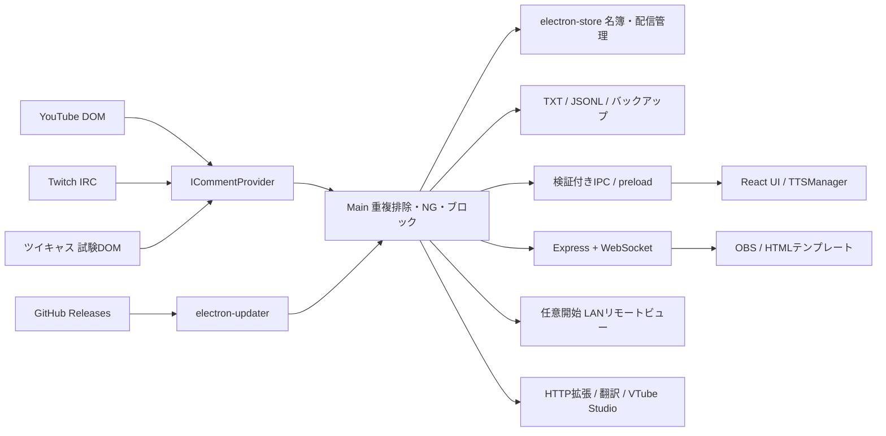

# CastPanel

Electron + Vite + React + TypeScriptのコメント統合ビュアー。OneCommeを参考にした独立実装です。**OneCommeの全機能や既存SDKとの完全互換は未達**です。無料版・PRO機能の対応範囲と残作業は[機能対応表](docs/FEATURES.md)で追跡しています。

## Windowsでビルド

`build.bat`をダブルクリックすると、未導入の依存関係のインストール、型チェック、ビルド、Windowsインストーラー作成を実行します。成果物は`release/`。GitHubへは公開しません。ビルドだけなら`build.bat --build-only`（出力は`dist/`）です。

再作成前に、旧版のエラーダイアログやCastPanelプロセスを終了してください。起動中の`release/win-unpacked`はWindowsにロックされます。依存関係の変更後は先に`npm ci`を実行します。

## 開発

Node.js 22.12以降または24を使用してください。

```sh
npm ci
npm run dev
npm test
npm run build
npm run dist
```

上部の接続表にURL／ユーザー名を入力し、接続スイッチをONにします。接続・読み上げ・名簿・ログ・OBSの各スイッチはその場で保存されます。枠名や接続先の入力はEnterまたは右上の「変更を保存」で反映します。日本語変換の確定中のEnterでは保存しません。音声・辞書などの設定変更も右上から保存します。参加型・投票・コメント操作などの各ボタンは即時反映します。

メイン画面は上部が接続表、中央がコメント、右がギフト・スパチャです。接続表は折りたたみでき、ギフト欄の表示切替と境界のドラッグによる幅調整ができます。幅と表示状態は端末内に保存します。コメントの2列表示・文字サイズ・列ごとの絞り込みにも対応。過去のコメントへスクロールすると新着への追従を止め、「最新のコメントへ」で復帰します。☆でストック、名前クリックで名簿編集、各行の「操作」で固定やミュートを行います。曲・ログ解析・連携などは「その他」から開きます。

接続先の「⋯」→「読み上げ設定」で、その枠だけの音声エンジン・speaker/style ID・Web Speech音声・速度・音量・名前読み上げ・優先度を設定できます。上書きOFFや未指定の項目は共通設定を使います。優先度0〜5は待機中のコメントに適用し、同じ優先度では受信順です。再生中の音声は中断せず、設定変更は待機中と以後のコメントに反映します。エンジン失敗時のWeb Speechへの切替は全体設定でOFFにできます。実製品の導入・話者ID・CORS等の設定と、実際の音声再生の確認は別途必要です。

ウィンドウの位置・サイズ・最大化状態、コメントの文字サイズ、接続表の開閉も保持します。モニターが外された場合は有効な画面内へ補正します。「設定」→「画面配置を初期化」でウィンドウと表示設定を初期状態へ戻せます。

## 実装機能

- 複数接続枠、YouTube非表示DOM監視、Twitch匿名IRC、ツイキャス試験DOM取得。
- 独立した接続・読み上げ・名簿記録・ログ出力・OBS出力スイッチ。
- コメント検索、2列表示、ギフト列、初見／NEW／再訪、固定・削除・コピー・ブロック・ミュート・しおり・ストック。
- 名簿、通算コメント、ギフト件数と通貨別集計、ニックネーム・メモ、検索・JSON出力。
- 参加待ち、参加／辞退ワード、順序変更・抽選・少回数優先、参加履歴。
- 選択式アンケート・クイズ・自由回答、1人1票、再投票・表記ゆれ統合、受付タイマー、過去の質問の再利用、OBS結果表示。
- コメント演出トリガー、ポン出し、クールダウン、VTube Studioホットキー連動。
- NG非表示／伏字、TTS置換、Web Speech、VOICEVOX、AivisSpeech、COEIROINK v2、棒読みちゃん接続。
- ローカル翻訳、曲名・歌手を編集できるセットリスト、配信開始時刻の手動指定、タイムスタンプの時刻・見出し編集と削除、TXT出力。
- TXT／JSONLログ、旧CastPanel TXT取込み、検索・解析、日付指定整理。
- 日次バックアップ・復元、コメントテスター、アプリ内ショートカット。
- OBS用4テーマ、用途別6ビュー、HTMLテンプレート追加、独自SDK、HTTP拡張。
- 任意開始のLANリモートビュー、Bearer認証付きローカル操作API。
- electron-updaterとGitHub Releases向けCI/CD。

## 構成



```text
src/shared/
  types.ts          コメント・設定・IPC契約
  studio.ts         配信管理モデル・Zodスキーマ・操作コマンド
  filter.ts         NG・TTS辞書
  gift.ts/media.ts  金額解析・画像ホスト制限
src/main/
  main.ts           起動・受信処理・IPC・終了・更新
  studio.ts         参加型・投票・ストック・演出・セットリスト
  storage.ts        electron-store・名簿・TXT出力
  archive.ts        JSONL・検索・解析・バックアップ
  server.ts         OBS・ローカル操作API
  overlay.ts        用途別オーバーレイ・テンプレートSDK
  remote.ts         トークン付き閲覧専用LANサーバー
  integrations.ts   LibreTranslate・HTTP拡張・VTube Studio
  bouyomi.ts        棒読みちゃんTCP
  providers/        ICommentProvider・各サービス
src/preload/        最小限のcontextBridge API
src/renderer/       React画面・管理パネル・TTSアダプター
tests/              ドメイン・保存・HTTP/WSテスト
scripts/smoke.mjs   Electron起動・IPC・復元・終了テスト
docs/FEATURES.md    公式機能との照合・未実装一覧
docs/EXTENSIONS.md  SDK・操作API・外部連携手順
```

## OBS

アプリの「OBS URLをコピー」で取得したURLをブラウザソースに設定します。既定は`http://127.0.0.1:11280/overlay`で、全表示です。背景透過。全表示は幅1200・高さ900程度、コメント専用は幅800・高さ900程度を目安にしてください。

他アプリとの競合を避けるため、以前の11180番固定は廃止しました。前回成功したポートを優先し、使用中・アクセス拒否の場合は11280〜11284、最後にOS割当の空きポートを試します。起動に成功したURLだけを画面に表示し、選ばれたポートは端末内の`server-state.json`へ保存します。URLが変わった場合はOBS側も差し替えて再読み込みしてください。`Route GET:/overlay not found`などのJSONが出る場合は、別サーバーへアクセスしていないかURLを確認してください。`/api/health`で`application: CastPanel`を確認できます。

| URLのパラメーター | 内容 |
|---|---|
| 指定なし／`?view=all` | 全表示（コメント・ギフト・固定・参加待ち・投票・セットリスト）。データのない補助欄は非表示 |
| `?view=comments` | コメント |
| `?view=gifts` | ギフトのみ |
| `?view=pinned` | 固定コメント |
| `?view=queue` | 参加待ち |
| `?view=poll` | 投票結果 |
| `?view=setlist` | セットリスト |

フォント、最大表示数、表示寿命はOBSタブで保存。テーマはOBSタブ上部の選択で即時保存します。「OBS URLをコピー」は機能メニュー右側にもあります。OBS出力OFFの接続枠は公開コメントと固定表示から除外します。

カスタムHTML、SDK、HTTPプラグイン、Stream DeckからのHTTP操作、翻訳、VTube Studio、リモートビューの詳細は[拡張手順](docs/EXTENSIONS.md)を参照してください。

## 保存仕様

- 保存場所はElectronの`app.getPath('userData')`。設定画面から開けます。
- 名簿のキーは`platform:userId`。初回／最終訪問と通算件数を保持。ギフト明細は直近100件、件数・通貨別合計は新しい形式で記録開始後は累積保存します。旧形式からの移行時は残っている明細だけで合計を初期化します。
- 同じIDの表示名変更は直近20件を記録し、名簿検索とリスナー編集画面から確認できます。ニックネーム変更はこの履歴に含みません。アイコン利用について本人に確認した結果も名簿に記録できます。
- NGとブロックは名簿・ログ・OBS・TTS・HTTP拡張より前に適用。非表示コメントは記録しません。伏字コメントは伏字で保存し、元の画像絵文字も除外します。
- TXTは`logs/YYYY-MM-DD_platform.txt`、ローカル日付で分割。JSONLはUTC日付で分割。時刻はISO UTC。
- 起動時、JSONLが存在しない旧CastPanel TXTを取込みます。OneCommeのログ形式インポートではありません。
- 検索は最大10万行、結果表示は最新500件。タイムラインは500件、重複IDは5000件、TTS待機は30件に制限。
- 起動時と1時間ごとに日次バックアップを判定。直近30ファイルを保持。設定（枠別音声を含む）・名簿（表示名履歴を含む）・配信管理を保存し、ログ・テンプレートの実ファイル・サイトCookie・VTube Studioトークン・端末固有の画面配置は含めません。
- 復元前にもバックアップを作成し、復元した接続はすべて停止状態にします。
- 設定と名簿は暗号化していません。VTube Studioの認証トークンのみ、利用可能ならOSのsafeStorageで暗号化保存します。

## 接続・外部製品の制約

YouTubeはAPIキー不要で、配信URL／@handle／チャンネルIDからlive_chatを開きます。DOMは公開APIではないため変更で壊れる可能性があります。同意画面・年齢制限・ログイン制限を自動回避しません。アプリ内サイトウィンドウでログイン後、接続を停止→開始してください。

Twitchは匿名IRCで得られるイベントだけです。すべてのチャンネルポイント引換や権限を要する通知にはOAuth／EventSubが必要ですが、現時点では未実装です。ツイキャスは実サイト未検証のDOM試験実装です。他サイトやYouTubeの全ギフト・モデレーションイベントは未対応です。

SuperChat金額はJPY、US$、EUR、GBPの明示的表記だけ正規化します。曖昧な`$`などはラベル表示のみ。通貨換算は行いません。画像絵文字は取得できたURLのうち、許可した配信サービスのホストだけ描画します。アバター・ユーザーバッジの完全な表示は未実装です。

音声は別途起動した各エンジンへ接続します。VOICEVOX 50021、AivisSpeech 10101、COEIROINK v2 50032、棒読みちゃんTCP 50001。speaker/style IDとCOEIROINKのspeaker UUIDは使用モデルに合わせて指定してください。CORSや音声ライブラリの設定は製品ごとに必要です。VOICEPEAK専用ブリッジは未実装です。

## セキュリティと終了

UIと配信サイトウィンドウはcontextIsolation・sandbox有効、Node無効。配信サイトにはpreloadやIPCを公開しません。受信データ・設定・コマンドを検証し、外部コメントはReact／textContentで表示します。

OBSサーバーは127.0.0.1のみで待受し、Host／Originを検証。公開データに名簿・メモ・設定・操作トークンを含めません。LANサーバーは明示開始時だけ別ポートで起動し、閲覧専用です。

メイン画面の×でアプリ全体を終了します。受信を停止し、非表示ウィンドウ・WebSocket・HTTPサーバーを閉じ、書込みをflushします。書込みが停止した場合は5秒を上限に終了します。

## 動作確認

1. テスターで通常コメントとギフトを送信。初見・再訪・累計件数を確認。
2. 各トグルのON/OFF、NG伏字／非表示、辞書、ブロック・ミュートを確認。
3. 参加受付を開始して「参加希望」を送信し、重複防止・辞退・順序変更を確認。
4. 投票を作成し、同一IDで1→2と送信。最新の1票だけが集計されることを確認。
   自由回答では接頭辞（既定`!投票`）を付けて回答します。最大100種類を集計し、全角半角・大小文字・空白の違いは正規化します。異なる回答も画面から統合でき、統合元の語での以後の投票も統合先に加算します。受付秒数が0なら無制限、1以上なら自動締切。再開すると設定秒数から数え直し、既存票は保持します。新しい質問を開始すると前の質問を最大30件保存し、履歴の再利用では票と自由回答をリセットします。同時受付は1問です。
5. ストック・固定・演出・セットリスト・タイムスタンプとOBS各URLを確認。
   「曲・時刻」で曲名と歌手を編集できます。配信開始日時は端末の現地時刻で手動指定し、未来日時は拒否します。既存タイムスタンプは相対秒数と見出しを編集・削除でき、表示・書き出しとも時刻順になります。開始日時を変更しても記録済みの相対秒数は保持します。
6. ログ検索・解析、バックアップ作成・復元、再起動後の保持を確認。
7. YouTube／Twitch／ツイキャスの自分の配信で、取得・ログイン・実ギフトを検証。
8. LAN別端末、各音声エンジン、翻訳・VTube Studioを使用環境で検証。
9. ×で終了し、プロセスと待受ポートが解放されることを確認。

```sh
node_modules\.bin\electron.cmd scripts/smoke.mjs
```

このスモークテストは一時データを使用し、画面・IPC・参加登録・投票・ログ・復元・非表示ウィンドウ込みの終了を確認します。画面は`.smoke-data/ui.png`。実配信受信・OBS・外部製品での音声・署名済み配布更新はこのテストに含みません。

## リリース

1. electron-builder.ymlのREPLACE_OWNER／REPLACE_REPOを実際のGitHubリポジトリへ変更。
2. Windows／macOS署名用のCSC_LINK・CSC_KEY_PASSWORD、macOS公証用のAPPLE_ID・APPLE_APP_SPECIFIC_PASSWORD・APPLE_TEAM_IDをGitHub Secretsに設定。配布者の証明書に応じて署名・公証設定を追加。
3. package.jsonのversionとロックファイルを更新してテスト・ビルド・実機確認。
4. versionと一致する`v0.2.0`などのタグをpush。CIがNSIS／dmg+zip／AppImageと更新メタデータをアップロード。
5. 全OS成果物とlatest*.ymlを確認してGitHub Releaseを公開。
6. インストール済み版から、起動時／手動確認、バックグラウンドDL、再起動適用を検証。開発モードでは更新無効。

公式資料: [Electron security](https://www.electronjs.org/docs/latest/tutorial/security)、[Twitch Chat](https://dev.twitch.tv/docs/chat)、[EventSub](https://dev.twitch.tv/docs/eventsub)、[electron-builder auto update](https://www.electron.build/auto-update.html)、[AivisSpeech API](https://aivis-project.github.io/AivisSpeech-Engine/api/)、[COEIROINK API](https://coeiroink.com/help/031)、[VTube Studio API](https://github.com/DenchiSoft/VTubeStudio)、[LibreTranslate API](https://docs.libretranslate.com/api/operations/translate/)。


### OBSレイアウト編集

「OBS」タブでゲーム・雑談・歌枠のプリセットを選択し、16:9のプレビュー上で各パーツをドラッグして配置します。右下のつまみでサイズ変更、矢印キーで移動、数値欄で位置と大きさを指定できます。「保存してOBSに反映」で永続化し、接続中のOBSにも即時反映します。

- 全表示の `/overlay` は保存したレイアウトを使用します。パーツごとのON/OFF、文字サイズ、最大件数、表示秒数を指定できます。
- 初期配置は最新コメント5件・30秒、ギフト通知1件・8秒、固定コメント1行、参加待ち5人、終了後の投票結果20秒です。セットリストは歌枠プリセットで有効になります。
- 固定コメントとギフトの通常コメントへの重複表示を抑制できます。参加待ちは受付中だけ表示する設定があります。内容がないパーツ、期限を過ぎたコメントや通知は表示されません。表示秒数0は無期限です。
- 個別URL（例: `/overlay?view=comments`）はパーツ単位でOBSに配置するためのものです。全表示の座標や表示ON/OFFには影響されず、件数・文字サイズ・時間設定を使用します。
- OBSのブラウザソースは1920×1080を推奨します。プレビューは配置用サンプルで、実際の受信コメントはOBSに表示されます。枠を超える内容はクリップされるため、必要に応じて高さ・件数・文字サイズを調整してください。

変更を配布版に反映するには `build.bat` を実行し、生成した新しいアプリを起動してください。

### 参加型管理（参考ツールから統合）

「参加型」タブに、プレイ中／待機中の管理、同時プレイ人数・連続回数上限、一括＋1・先頭交代・上限者交代・完了、最大30操作の取り消し、手動追加、定員、再参加待ち時間、完全一致の受付ワード判定、参加専用ブラックリスト、参加履歴と操作記録、均等なランダムチーム分けを追加しました。既存の参加回数は維持し、新しい連続プレイ回数と通算プレイ回数は別に記録します。

「交代」は最後尾へ移動し連続回数を0に戻します。「完了」は退出して完了回数を加算します。取り消し後も、操作後に新しくコメント参加した人は末尾に残します。参加禁止は手動追加にも適用します。手動追加は受付停止・再参加待ち時間を無視しますが、定員は適用します。チーム分けはラベル割当であり、チーム単位の自動交代は行いません。

「OBS見た目」でリスト／カード／チップ／1行バー／スポットライト、テーマ、表示ラベル、回数・上限・番号・待機者、上限の点滅、登場アニメを設定できます。「この見た目の専用URLをコピー」は見た目の設定をURLに固定します。「操作ドックURLをコピー」はOBSのカスタムブラウザドックに追加でき、受付切替・一括加算・交代・取り消しができます。操作権限を含むURLは共有せず、アプリを再起動したら再コピーしてください。

アプリ右上の「外観」でアプリ全体のテーマ、OBSタブ上部でOBS共通テーマ、参加型のOBS見た目で参加型だけのテーマを選択できます。従来4種にライト・ネオン・サクラ・パープル・ガラス・レトロ・ミニマル・ゴールド・ミント・オーシャン・サンセットを追加し、合計15種です。

詳細と参考ツールとの差分は [参加型管理](docs/PARTICIPATION.md) を参照してください。

### 参加型フル管理と自由なテーマ編集

参加型は簡易版を置き換える方針で、添付ツールのフル管理画面・9種類のカード・素材／音声取込み・グローバルキー・最前面ミニ表示・Twitch認証とポイント受付を統合しました。「参加型」→「フル管理を開く」から利用できます。ほかの管理画面も「別ウィンドウ」で切り離せます。

「テーマ編集」では配色・角丸・枠線・透過・影・フォントを編集し、最大30個を保存・複製・JSON共有できます。アプリ／OBS／参加型へ個別適用し、別ウィンドウにも同期します。詳しい操作・保存範囲・実環境での確認事項は [参加型フル管理](docs/PARTICIPATION.md) を参照してください。
